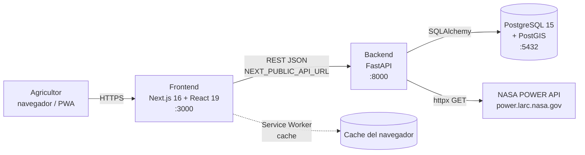
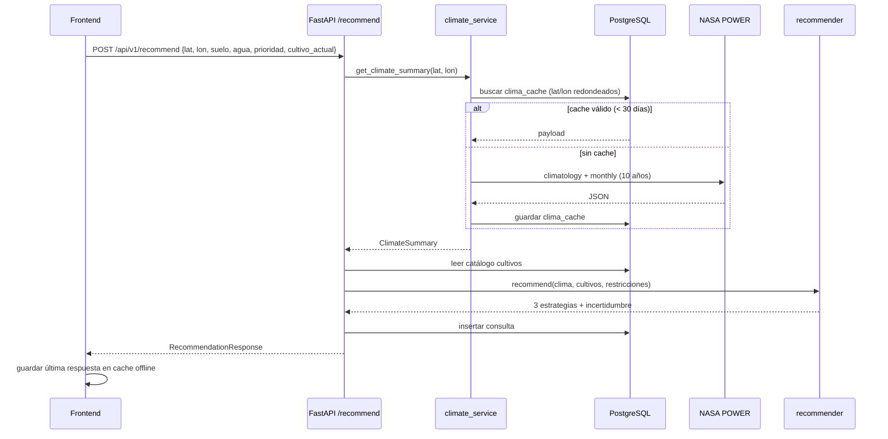
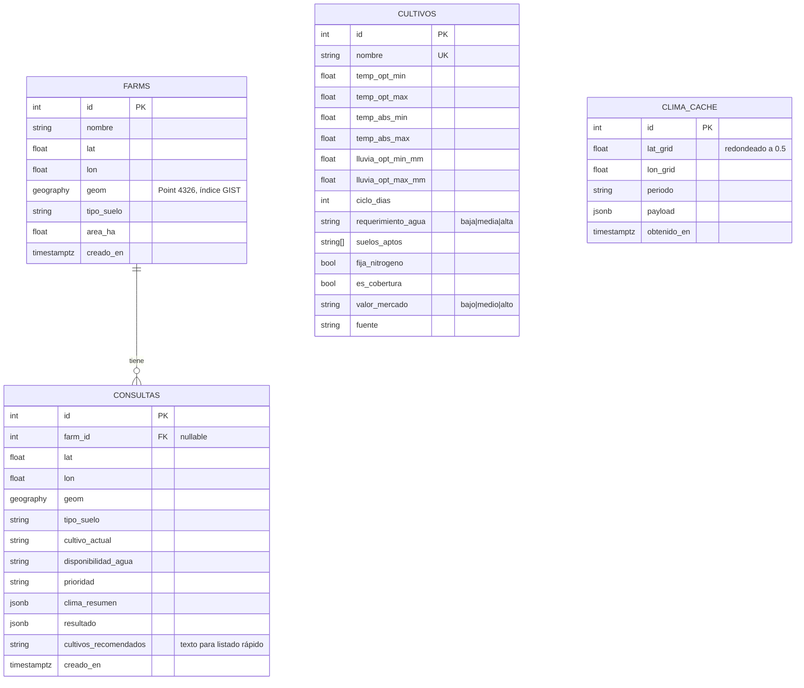

# Arquitectura — NasaSpaceApp (DSS Agrícola)

> Documento fuente de verdad del proyecto. Si cambias el contrato de la API, el modelo de datos
> o la estructura de carpetas, **actualiza este archivo en el mismo PR**.

Versión: 1.0 · Fecha: 2026-11-14

---

## 1. Problema y propuesta

**Reto:** NASA Space Apps — "Cambio de campo".
**Producto:** Sistema de Apoyo a la Decisión (DSS) para agricultores: dado **dónde** está su parcela
y **qué restricciones** tiene (agua, suelo, prioridad), recomendar estrategias de cultivo/rotación
**basadas en datos reales de NASA**, explicando beneficios, riesgos, compensaciones (tradeoffs) e
incertidumbre.

**Principio clave:** el usuario **no captura** temperatura ni lluvia a mano. Las elige en el mapa
(lat/lon) y el backend obtiene el clima de **NASA POWER**.

### Alcance MVP (lo que se presenta)

1. Seleccionar ubicación en un mapa (o escribir coordenadas).
2. Ver el resumen climático NASA de esa ubicación (temperatura, lluvia, humedad de suelo en raíz, por mes).
3. Recibir 3 estrategias con puntaje 0–100 y explicación.
4. Historial de consultas y parcelas guardadas.
5. App instalable (PWA) que muestra la interfaz y la última consulta sin internet.

### Fuera de alcance MVP (solo si sobra tiempo)

- SMAP / GPM IMERG directos (requieren cuenta Earthdata y procesar rasters).
- Modelo de Machine Learning entrenado. **No llamar "ML" a reglas**; los jueces lo notan.
- Autenticación de usuarios.

---

## 2. Vista general (C4 — contenedores)



| Contenedor | Tecnología | Responsabilidad | Dueño |
|---|---|---|---|
| Frontend | Next.js 16.4, React 19.3, Tailwind 4, TypeScript, react-leaflet | UI, mapa, PWA/offline | Fernando, hdmiaa, menaxmn |
| Backend | Python 3.11, FastAPI, Pydantic v2, httpx | API, integración NASA, motor de recomendación | Mauro (Maurongas) |
| Base de datos | PostgreSQL 15 + PostGIS 3.3, SQLAlchemy 2, Alembic, GeoAlchemy2 | Persistencia, migraciones, catálogo de cultivos, caché de clima | Daniel (daniel379618) |
| Fuente externa | NASA POWER (sin API key) | Clima histórico por punto | — |

Todo corre con `docker compose up --build` (ver `docs/GUIA-INICIO.md`).

---

## 3. Flujo principal: obtener una recomendación



Si NASA no responde y no hay caché → `503` con `{"detail": "NASA POWER no disponible"}`.

---

## 4. Estructura de carpetas (oficial)

> Nota: los issues mencionan `frontend/src/...`. **No usamos** `src/`: la ruta real es `frontend/app/`.

```
NasaSpaceApp/
├── docker-compose.yml
├── .env.example                 # variables de entorno (copiar a .env)
├── CLAUDE.md                    # contexto general para Claude Code
├── docs/
│   ├── ARQUITECTURA.md          # este archivo
│   ├── GUIA-INICIO.md, GUIA-GIT.md
│   └── contexto/                # contexto por rol para Claude
├── backend/
│   ├── Dockerfile
│   ├── requirements.txt         # versiones fijadas
│   ├── alembic.ini
│   ├── alembic/versions/        # migraciones            [DBA]
│   ├── tests/                   # pytest                 [ambos]
│   └── app/
│       ├── main.py              # crea app, CORS, incluye routers   [Backend]
│       ├── core/config.py       # Settings desde env (pydantic-settings) [DBA]
│       ├── db/
│       │   ├── database.py      # engine, SessionLocal, Base, get_db [DBA]
│       │   └── seed.py          # carga catálogo de cultivos         [DBA]
│       ├── models/              # SQLAlchemy                          [DBA]
│       │   ├── farm.py  consulta.py  cultivo.py  clima_cache.py
│       ├── repositories/        # consultas SQL reutilizables         [DBA]
│       │   ├── farms.py  consultas.py  cultivos.py  clima_cache.py
│       ├── schemas/             # Pydantic (contrato API)             [Backend]
│       │   ├── farm.py  climate.py  recommendation.py  history.py
│       ├── api/v1/              # routers                             [Backend; farms/history con DBA]
│       │   ├── climate.py  recommend.py  farms.py  history.py
│       ├── services/                                                  [Backend]
│       │   ├── nasa_power.py    # cliente HTTP NASA POWER
│       │   ├── climate.py       # resumen climático + caché
│       │   └── recommender.py   # motor de puntaje
│       └── data/cultivos.json   # catálogo semilla (fuente: FAO ECOCROP) [DBA]
└── frontend/
    ├── Dockerfile
    ├── next.config.ts
    ├── public/  sw.js  icons/                                         [PWA]
    └── app/                                                           
        ├── layout.tsx           # Navbar + tema                       [Layout]
        ├── page.tsx             # Inicio: mapa + formulario + resultados [Layout + Mapa]
        ├── historial/page.tsx                                         [Layout]
        ├── manifest.ts          # manifiesto PWA                      [PWA]
        ├── components/
        │   ├── Navbar.tsx  ResultCards.tsx  ClimateCard.tsx           [Layout]
        │   ├── MapComponent.tsx  LocationPicker.tsx                   [Mapa]
        │   └── OfflineBanner.tsx  InstallPrompt.tsx  SWRegister.tsx   [PWA]
        └── lib/
            ├── types.ts         # tipos TS del contrato (espejo de schemas/) [PWA, revisa Backend]
            ├── api.ts           # cliente fetch + fallback a cache          [PWA]
            └── offline.ts       # guardar/leer última consulta              [PWA]
```

---

## 5. Contrato de la API (v1)

Base: `${NEXT_PUBLIC_API_URL}` (local: `http://localhost:8000`). Todo JSON. Documentación viva en `/docs`.

| Método | Ruta | Descripción | Dueño |
|---|---|---|---|
| GET | `/health` | Estado del backend y de la BD | Backend |
| GET | `/api/v1/climate?lat=&lon=` | Resumen climático NASA de un punto | Backend |
| POST | `/api/v1/recommend` | Clima + recomendación; guarda consulta | Backend |
| GET | `/api/v1/history?limit=20` | Últimas consultas | DBA (repo) + Backend (router) |
| POST | `/api/v1/farms` | Crear parcela | DBA + Backend |
| GET | `/api/v1/farms` | Listar parcelas | DBA + Backend |
| GET | `/api/v1/farms/{id}` | Detalle de parcela | DBA + Backend |
| GET | `/api/v1/crops` | Catálogo de cultivos (para selects) | DBA + Backend |

### 5.1 `GET /api/v1/climate?lat=31.86&lon=-116.60`

```json
{
  "lat": 31.86, "lon": -116.6,
  "fuente": "NASA POWER (community=AG)",
  "periodo": "2015-2024",
  "temp_media_anual_c": 17.4,
  "temp_max_media_c": 24.1,
  "temp_min_media_c": 10.8,
  "lluvia_anual_mm": 262.0,
  "humedad_suelo_raiz": 0.31,
  "cv_lluvia_pct": 38.5,
  "mensual": [
    {"mes": 1, "temp_c": 13.2, "lluvia_mm": 48.1, "humedad_suelo_raiz": 0.38}
  ]
}
```

- `humedad_suelo_raiz`: fracción 0–1 (`GWETROOT` de POWER).
- `cv_lluvia_pct`: coeficiente de variación de la lluvia anual (desviación estándar / media) → base de la incertidumbre.
- `mensual`: 12 elementos.

### 5.2 `POST /api/v1/recommend`

Request:

```json
{
  "lat": 31.86, "lon": -116.6,
  "farm_id": null,
  "tipo_suelo": "arcilloso",
  "cultivo_actual": "maiz",
  "disponibilidad_agua": "media",
  "prioridad": "conservar_agua"
}
```

Valores permitidos (enums):

- `tipo_suelo`: `arcilloso | arenoso | limoso | franco`
- `disponibilidad_agua`: `baja | media | alta`
- `prioridad`: `conservar_agua | mejorar_suelo | ingresos_extra`
- `lat` ∈ [-90, 90], `lon` ∈ [-180, 180] → si no, `422`.

Response `200`:

```json
{
  "consulta_id": 42,
  "clima": { "...": "ClimateSummary (5.1)" },
  "incertidumbre": { "nivel": "alta", "motivo": "La lluvia anual varía 38% entre años" },
  "recomendaciones": [
    {
      "tipo": "actual",
      "titulo": "Mantener cultivo actual",
      "cultivo": "Maíz",
      "puntaje": 41,
      "desglose": {"temperatura": 0.9, "agua": 0.2, "suelo": 1.0, "prioridad": 0.0},
      "justificacion": ["Temperatura dentro del rango óptimo", "Requiere ~500 mm; disponibles ~262 mm + riego medio"],
      "beneficios": "Sin curva de aprendizaje; mercado conocido.",
      "riesgos": "Déficit hídrico probable en años secos.",
      "tradeoff": "Mantienes tu mercado pero aumentas el riesgo de pérdida."
    },
    { "tipo": "optimizada",  "...": "..." },
    { "tipo": "resiliente",  "...": "..." }
  ]
}
```

- Siempre 3 recomendaciones, en el orden `actual`, `optimizada`, `resiliente`.
- `tradeoff` es una oración ya lista para mostrar (sin el prefijo "Tradeoff:").

### 5.3 `GET /api/v1/history`

```json
[
  {
    "id": 42, "fecha": "2026-11-14T18:22:10Z",
    "lat": 31.86, "lon": -116.6, "farm_nombre": null,
    "tipo_suelo": "arcilloso", "cultivo_actual": "maiz",
    "temp_media_anual_c": 17.4, "lluvia_anual_mm": 262.0, "humedad_suelo_raiz": 0.31,
    "cultivos_recomendados": ["Maíz", "Sorgo", "Garbanzo"]
  }
]
```

### 5.4 Farms

`POST /api/v1/farms` → `{ "nombre": "Parcela Norte", "lat": 31.86, "lon": -116.6, "tipo_suelo": "arcilloso", "area_ha": 3.5 }`
Response: el mismo objeto con `id` y `creado_en`.

### 5.5 Errores

| Código | Cuándo |
|---|---|
| 422 | Validación (Pydantic) |
| 404 | `farm_id` no existe |
| 503 | NASA POWER caído y sin caché |

Formato: `{"detail": "mensaje legible en español"}`.

---

## 6. Modelo de datos



Reglas:

- **Migraciones con Alembic** (no `create_all`). El contenedor backend corre `alembic upgrade head` antes de levantar uvicorn.
- `clima_cache`: único en `(lat_grid, lon_grid, periodo)`. La malla de NASA POWER es de ~0.5°, así que redondear evita llamadas repetidas.
- `cultivos` se llena con `app/db/seed.py` desde `app/data/cultivos.json` (idempotente: hace upsert por `nombre`).
- La tabla vieja `historial_consultas` se reemplaza por `consultas` (migración que la elimina).

---

## 7. Motor de recomendación (`services/recommender.py`)

Reglas transparentes y explicables (no ML).

**Entradas:** `ClimateSummary`, lista de `Cultivo`, restricciones del usuario.

**Agua disponible estimada** = `lluvia_anual_mm` + aporte de riego según `disponibilidad_agua`
(`baja: 0`, `media: 300`, `alta: 800` mm; constantes en `core/config.py`, ajustables).

**Puntaje por cultivo (0–1 cada uno):**

| Factor | Cálculo | Peso |
|---|---|---|
| temperatura | 1 si `temp_media` ∈ [opt_min, opt_max]; baja linealmente a 0 en los límites absolutos | 0.40 |
| agua | 1 si agua disponible ∈ [lluvia_opt_min, lluvia_opt_max]; proporcional si falta; 0.8 si sobra | 0.35 |
| suelo | 1 si `tipo_suelo` ∈ `suelos_aptos`, si no 0.5 | 0.15 |
| prioridad | `conservar_agua` → req. baja = 1; `mejorar_suelo` → fija N o cobertura = 1; `ingresos_extra` → valor alto = 1 | 0.10 |

`puntaje = round(100 × Σ peso·factor)`. Si un factor es 0 → puntaje × 0.5 (cultivo inviable).

**Las 3 estrategias:**

1. `actual`: el cultivo actual evaluado con la misma fórmula (si no está en el catálogo, se avisa).
2. `optimizada`: el de mayor puntaje que no sea el actual.
3. `resiliente`: el de mayor puntaje entre `requerimiento_agua = baja` o `es_cobertura = true`, distinto de los anteriores.

**Incertidumbre:** `cv_lluvia_pct` < 15 → baja · 15–30 → media · > 30 → alta. Sube un nivel si `humedad_suelo_raiz` < 0.3.

`justificacion` se genera a partir del `desglose` (frases por factor), así cada recomendación explica de dónde sale.

---

## 8. Integración NASA POWER (`services/nasa_power.py`)

Sin API key. Docs: https://power.larc.nasa.gov/docs/services/api/

| Uso | Endpoint |
|---|---|
| Promedios mensuales de largo plazo | `GET /api/temporal/climatology/point` |
| Serie mensual de 10 años (para variabilidad) | `GET /api/temporal/monthly/point?start=2015&end=2024` |

Parámetros comunes: `parameters=T2M,T2M_MAX,T2M_MIN,PRECTOTCORR,GWETROOT&community=AG&latitude=..&longitude=..&format=JSON`

Notas:

- Los valores van en `properties.parameter.<PARAM>`; las unidades, en `parameters.<PARAM>.units`. **Verificar unidades**: la precipitación viene en mm/día → multiplicar por los días del mes.
- `-999` = sin dato → ignorar.
- En el endpoint mensual, el "mes 13" (ej. `201513`) es el promedio anual.
- Timeout de 20 s y 2 reintentos. Siempre pasar por `clima_cache`.

---

## 9. Frontend

- **Estado de la página de inicio:** `ubicacion {lat, lon}` (lo llena el mapa) + formulario → `api.recommend()` → resultados.
- **Mapa:** react-leaflet con `dynamic(..., { ssr: false })` (Leaflet usa `window`). Un clic mueve el marcador y actualiza `lat/lon`.
- **Cliente API único** (`lib/api.ts`): nadie hace `fetch` directo en los componentes. Base URL desde `process.env.NEXT_PUBLIC_API_URL`.
- **Tipos** (`lib/types.ts`): espejo exacto de la sección 5.
- **PWA:** `app/manifest.ts` nativo de Next + `public/sw.js` propio registrado por `SWRegister.tsx`. **No usar** `next-pwa` (no está mantenido y no es compatible con Next 16/Turbopack). Estrategia: cache-first para el app shell y estáticos, network-first para `/api/`*, y la última recomendación se guarda en `localStorage`/IndexedDB.
- Idioma: español (`<html lang="es">`).

---

## 10. Configuración y entornos

`.env.example` (se copia a `.env`; `.env` no se sube a git):

```
POSTGRES_USER=admin
POSTGRES_PASSWORD=password
POSTGRES_DB=agridb
DATABASE_URL=postgresql+psycopg://admin:password@db:5432/agridb
CORS_ORIGINS=http://localhost:3000
NASA_POWER_BASE_URL=https://power.larc.nasa.gov/api
CLIMA_CACHE_DIAS=30
NEXT_PUBLIC_API_URL=http://localhost:8000
```

---

## 11. Convenciones de trabajo

- **Ramas:** `feature/<area>-<tema>` (como en los issues) → PR a `main` con la plantilla. Mínimo 1 revisión.
- **Cambios de contrato** (secciones 5 o 6): el PR debe tocar este documento **y** `frontend/app/lib/types.ts`/`backend/app/schemas/`. Avisar al equipo.
- **Commits:** `feat:`, `fix:`, `chore:`, `docs:`.
- **Python:** type hints, Pydantic v2 (`model_config = ConfigDict(from_attributes=True)`), `datetime.now(timezone.utc)`.
- **TS:** sin `any` en datos de la API; usar los tipos de `lib/types.ts`.
- **No subir:** `.env`, `node_modules`, `.next`, `__pycache__`.

---

## 12. Plan por fases

| Fase | Objetivo | Entregables |
|---|---|---|
| 0 — Base (hoy) | Reestructurar sin romper | `core/config.py`, `db/`, `.env.example`, Alembic, layout + Navbar |
| 1 — Datos reales | NASA → backend | `nasa_power.py`, `/climate`, `clima_cache`, mapa que selecciona lat/lon |
| 2 — Recomendación | Lógica real | `cultivos` sembrados, `recommender.py`, `/recommend` nuevo, tarjetas de resultados |
| 3 — Persistencia y UX | Historial, parcelas, PWA | `/history`, `/farms`, manifest + SW + offline |
| 4 — Pulido | Demo | Gráficas mensuales, textos, video/pitch, datos de 2–3 ubicaciones de demo ya en caché |

## 13. Mapeo issues ↔ arquitectura

| Issue | Responsable | Corresponde a |
|---|---|---|
| #1 Layout y Navegación | FernandoBorbas | §4 `layout.tsx`, `Navbar`, `ResultCards`, `historial` |
| #2 Mapa Interactivo | hdmiaa | §9 `MapComponent`, `LocationPicker` |
| #3 PWA (Offline) | menaxmn | §9 PWA + `lib/api.ts`, `lib/offline.ts` (**sin next-pwa**) |
| #4 Modelos de BD | daniel379618 | §6 completo, `db/`, `models/`, `repositories/`, Alembic, seed |
| #5 Conexión API NASA | Maurongas | §3, §5, §7, §8: `services/`, `schemas/`, `api/v1/` |
